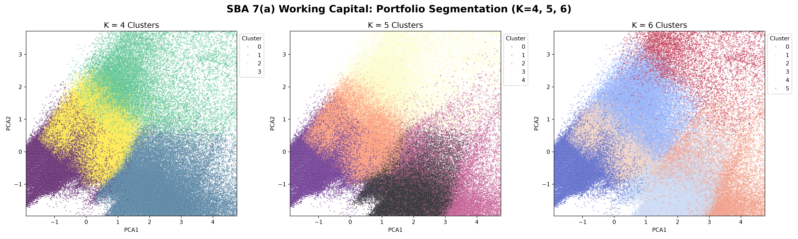
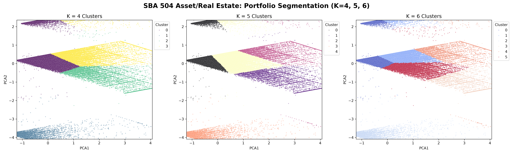
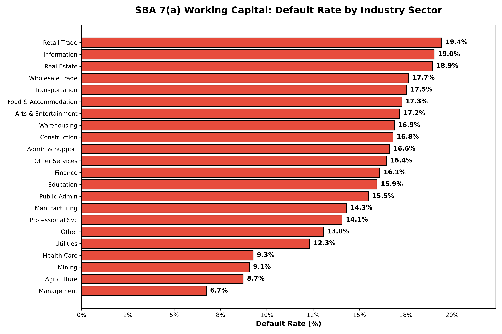
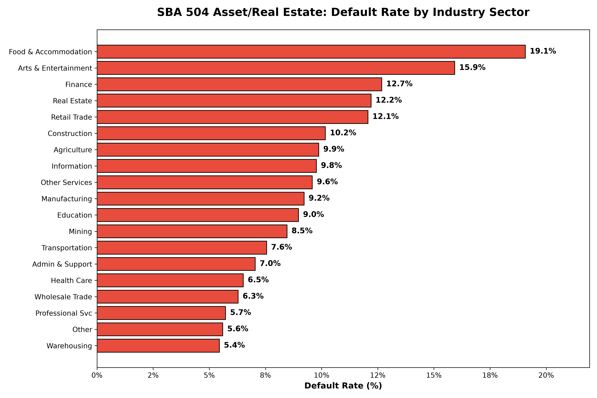
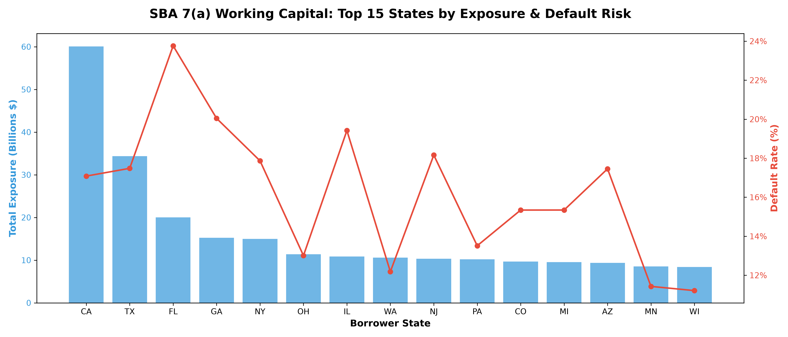
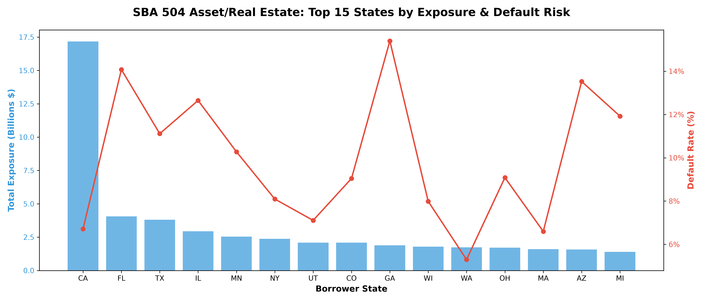

# SBA-Analytics-Engineering
End-to-end ETL pipeline and Credit Risk Data Mart for 30 years of SBA 7(a) and 504 loan data. Features schema drift handling, Parquet optimization, Advanced SQL (CTEs/Window Functions), and portfolio risk visualizations.

# SBA Analytics Engineering & Credit Risk Data Mart

An end-to-end Data Engineering and Data Science pipeline built on 30 years of SBA 7(a) and 504 loan data (1.5 million loans). This project demonstrates schema drift handling, Parquet optimization, Advanced SQL (CTEs/Window Functions), Portfolio Risk Visualizations, and Unsupervised Machine Learning (K-Means Clustering) to inform PD/LGD modeling.

## Overview
This repository bridges the gap between Data Engineering and Credit Risk Analytics. It moves 30 years of legacy government data from raw CSVs into a highly optimized SQLite/Parquet Data Mart, and applies statistical modeling and clustering to uncover portfolio concentration risks and risk-based segmentation.

## 🛠️ The Data Engineering Journey
*   **Schema Drift & Mixed Data Types:** Historical files had inconsistent data types (e.g., ZIP codes as integers in 1991 but strings in 2010). *Solution: Engineered a schema conformity step that casts all object columns to strict strings.*
*   **Data Corruption:** The 7(a) dataset contained inconsistent Loan Status strings (e.g., `P I F` instead of `PIF`). *Solution: Standardized fields using Regex stripping.*
*   **Optimization:** Converted raw CSVs to **Parquet format** (10x faster analytical queries) and deployed a relational **SQLite database**.
*   **Advanced SQL Data Mart:** Built a reusable Data Mart utilizing **CTEs** and **Window Functions (LAG, AVG OVER)** to calculate YoY default rate changes and 3-year rolling averages.

---

## 📊 EDA: Macroeconomic & Recovery Insights

### 1. Macroeconomic Vintage Trends (GFC vs. COVID)
The Data Mart reveals the clear impact of macroeconomic shocks. The 2008 Global Financial Crisis caused a massive spike in defaults. In contrast, the 2020 COVID-19 spike was artificially suppressed by government relief programs, resulting in a delayed default peak in 2022–2023.

### 2. Empirical LGD (The Collateral Effect)
By calculating the Realised Loss Given Default (LGD), we proved that 504 loans (Real Estate backed) recover slightly more capital than 7(a) Working Capital loans. This is a critical insight for IFRS 9 Expected Credit Loss (ECL) modeling.

---

## 🤖 Unsupervised Learning: Portfolio Segmentation

We applied K-Means Clustering to segment both loan portfolios based on `GrossApproval`, `TermInMonths`, `JobsSupported`, and `InterestRate`. We tested K=2 through K=8, validating that **K=4** provides the most distinct, non-overlapping business segments.

### 1. SBA 7(a) Working Capital Segmentation

*Figure 1: PCA comparison of K=4, K=5, and K=6 clusters for the 7(a) dataset.*

**Business Profiles (K=4):**
*   **Large CRE:** $1.23M avg, 270-month term.
*   **Large Enterprise:** $907k avg, 65 jobs per loan.
*   **Standard SME:** $192k avg, 87-month term (Volume driver).
*   **High-Risk Micro-business:** $75k avg, but with a massive **9.03% interest rate**.

### 2. SBA 504 Asset/Real Estate Segmentation

*Figure 2: PCA comparison of K=4, K=5, and K=6 clusters for the 504 dataset.*

**Business Profiles (K=4):**
*   **Large CRE:** $1.42M avg, 244-month term.
*   **High-Job Enterprise:** $718k avg, 79 jobs per loan.
*   **Medium Equipment:** $406k avg, 118-month term.
*   **Standard Real Estate:** $354k avg, 241-month term (Volume driver).

**The Key Insight:** The 7(a) program has a massive spread of terms (7, 10, and 22 years) because it funds working capital. The 504 program is almost entirely 20-year terms because it is primarily for buying buildings/land.

---

## 🏭 Industry Concentration Risk (NAICS)

We mapped raw 2-digit NAICS codes to standard industry names to identify which sectors pose the highest default risk.

### SBA 7(a) Working Capital

### SBA 504 Asset/Real Estate

**Business Insight:** The **Food & Accommodation (Restaurants)** and **Retail Trade** sectors exhibit the highest default rates in the 7(a) portfolio. The 504 portfolio, backed by real estate, shows a more resilient default profile across all sectors.

---

## 🗺️ Geographic Concentration Risk

To identify regional risk, we analyzed the top 15 states by loan volume and compared their exposure against their default rates.

### SBA 7(a) Geographic Risk

### SBA 504 Geographic Risk

**Business Insight:** Both portfolios show massive concentration in California (CA), Texas (TX), and Florida (FL). However, the 504 program maintains a more stable default rate across these states due to the geographic diversification of the underlying real estate assets.

---

## 💡 Strategic Application: How Clustering Informs PD & LGD Modeling

This segmentation is not just descriptive; it is highly prescriptive for downstream quantitative modeling:

1.  **Segmented PD Modeling:** Instead of one global model, we can build separate PD models for the High-Risk (Food/Retail) vs. Low-Risk (Health Care) sectors. This prevents features like "Interest Rate" from washing out due to conflicting risk profiles across industries.
2.  **LGD and Collateral:** The 504 clusters (mostly 20-year Real Estate) have inherently lower LGDs due to foreclosable collateral. The 7(a) High-Risk Micro-businesses (working capital) will have higher LGDs. 
3.  **IFRS 9 SICR Staging:** Clustering allows for **relative SICR thresholds**. A PD increase from 1% to 3% for a Health Care loan (a 3x increase) should trigger Stage 2. But a PD increase from 15% to 17% for a Retail loan (a 13% increase) should not, because it's already priced into the high-risk baseline.

---

## How to Run Locally
1. Clone the repository.
2. Install dependencies: `pip install pandas numpy pyarrow matplotlib seaborn scikit-learn sqlite3`.
3. Run the Jupyter Notebook to process the raw CSVs into the Data Mart, and execute the clustering algorithms.

---
**Author:** Raymond Sibanda | [LinkedIn](https://www.linkedin.com/in/raymond-sibanda-91850613b) |
FRM | BSc Mathematics | BCom Honors Accounting
