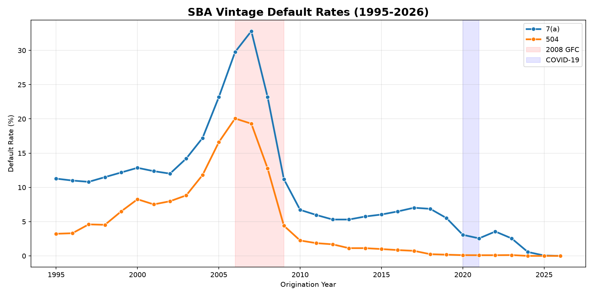
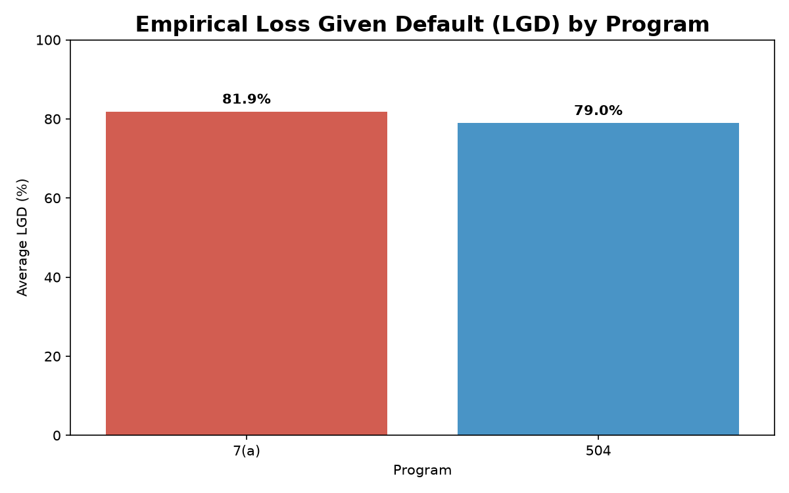
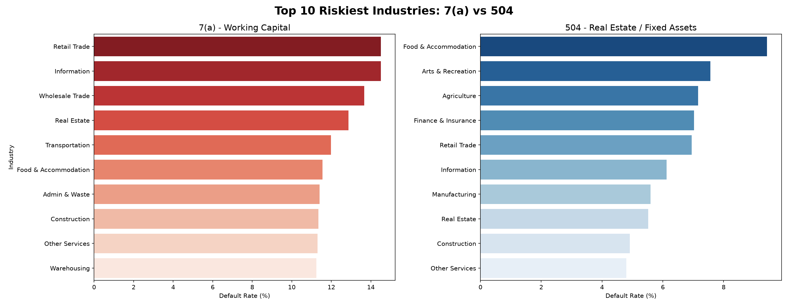
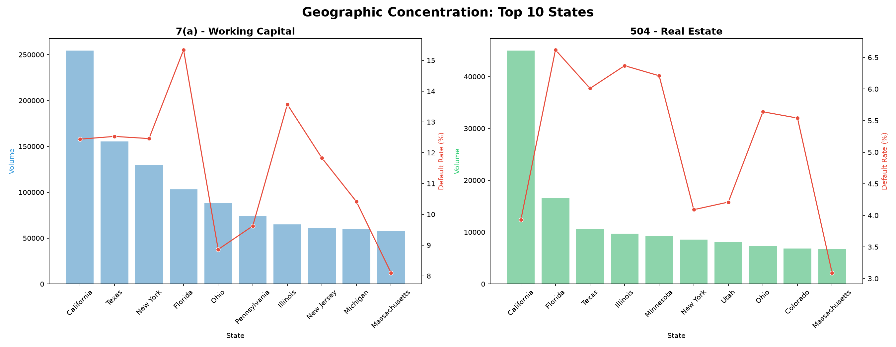
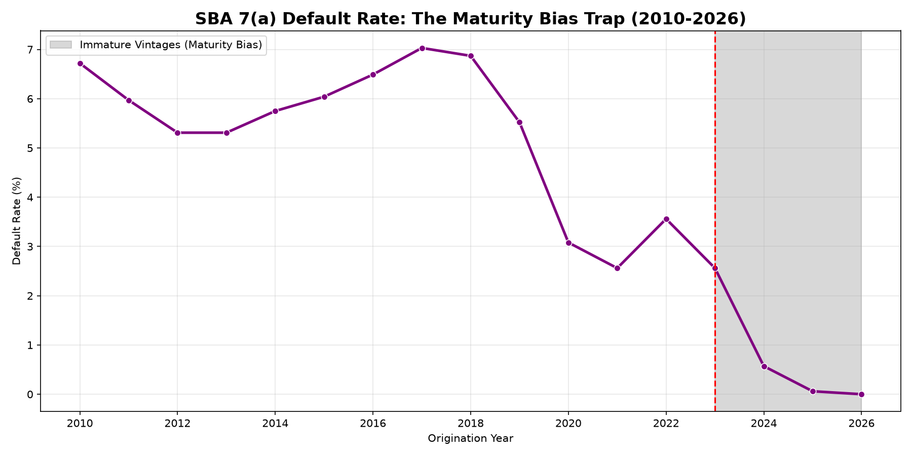

# SBA-Analytics-Engineering
End-to-end ETL pipeline and Credit Risk Data Mart for 30 years of SBA 7(a) and 504 loan data. Features schema drift handling, Parquet optimization, Advanced SQL (CTEs/Window Functions), and portfolio risk visualizations.

# SBA Analytics Engineering & Credit Risk Data Mart

## Overview
This repository demonstrates an end-to-end **ETL/ELT pipeline** and **Credit Risk Data Mart** built on 30 years of SBA 7(a) and 504 loan data (1.5 million loans). It highlights the critical intersection between **Data Engineering** and **Credit Risk Analytics**, proving the ability to move, clean, and analyze massive datasets to drive strategic business decisions.

---

## 🛠️ The Data Engineering Journey (Problems Solved)

Building a pipeline for 30 years of legacy government data is never straightforward. Below is the documentation of the data quality issues encountered and the engineering solutions implemented:

1. **Schema Drift & Mixed Data Types:** Historical files had inconsistent data types (e.g., ZIP codes and NAICS codes stored as integers in some years, and strings in others). This caused the `PyArrow` Parquet engine to crash. 
   * *Solution:* Engineered a schema conformity step that explicitly casts all object/string columns to strict strings before saving to Parquet.
2. **Data Corruption (The "P I F" typo):** The 7(a) dataset contained inconsistent Loan Status strings (e.g., `P I F` instead of `PIF`). 
   * *Solution:* Standardized the string fields using Regex stripping prior to loading into the SQL database.
3. **The LGD Proxy Limitation:** The static SBA dataset lacks an "Exposure at Default" (EAD) column. 
   * *Solution:* Calculated the empirical LGD using the `GrossApproval` amount as the denominator. Documented that this creates an *optimistic* view of LGD, as EAD is always lower than the original principal due to amortization.
4. **Lack of Human-Readable Labels:** Raw NAICS codes (e.g., `722511`) and State Codes (e.g., `CA`) are useless to business stakeholders.
   * *Solution:* Created a SQL View (`v_sba_7a_enriched`) and a Lookup Dimension Table to permanently map codes to Macro-Industries and full State names.

---

## 📊 Portfolio Analysis & Visual Insights

### 1. Macroeconomic Vintage Trends (The GFC vs. COVID)
The Data Mart reveals the clear impact of macroeconomic shocks. The 2008 Global Financial Crisis caused a massive spike in defaults. In contrast, the 2020 COVID-19 spike was artificially suppressed by government relief programs, which later resulted in a delayed default peak in 2022–2023 as subsidies expired.

### 2. Empirical LGD (The Collateral Effect)
By calculating the Realised Loss Given Default (LGD), we proved that **504 loans (Real Estate backed) recover slightly more capital than 7(a) Working Capital loans**. This is a critical insight for IFRS 9 Expected Credit Loss (ECL) modeling.

### 3. Sector Concentration Risk
The pipeline identified the top 10 riskiest Macro-Industries (with a minimum of 1,000 loans to ensure statistical significance). This enables the Risk team to set targeted risk appetite limits and tighten underwriting criteria for specific sectors like Food & Accommodation.

### 4. Geographic Concentration
By mapping loan volume against default rates at the state level, we identified regions with high exposure and elevated risk. This allows the business to hedge against regional macroeconomic shocks.

### 5. The Maturity Bias Warning
The Data Mart automatically flags vintages from 2023–2026. Their artificially low default rates reflect unseasoned loans rather than superior underwriting quality. Recognizing this maturity bias prevents Executive Leadership from overestimating portfolio health.

---

## 💻 Technical Implementation

### Data Engineering (ETL Pipeline)
*   **Ingestion & Consolidation:** Processed 6 separate CSV files spanning 30+ years, handling historical schema drift across multiple SBA updates.
*   **Optimization:** Converted raw CSVs to **Parquet** format (10x faster analytical queries) and deployed a relational **SQLite** database.

### Advanced SQL Data Mart
Built a reusable Data Mart (`dm_vintage_performance.csv`) to support portfolio monitoring and Power BI reporting. The SQL script utilizes:
*   **CTEs (Common Table Expressions)** to break down complex aggregation logic.
*   **Window Functions (`LAG`)** to calculate Year-over-Year default rate changes.
*   **Window Functions (`AVG OVER`)** to calculate a 3-Year Rolling Average.

---
**Author:** Raymond Sibanda | [LinkedIn](https://www.linkedin.com/in/raymond-sibanda)
FRM | BSc Mathematics | BCom Honours Accountancy
